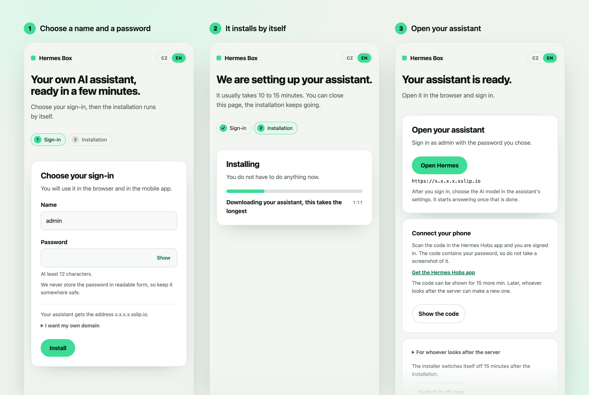

# HobCrew Box

HobCrew Box runs [Hermes Agent](https://github.com/NousResearch/hermes-agent) on your own
server: the agent with its cron jobs, the Webapp (Hermes Desktop in a browser,
including Bots) on your domain, and a daily backup.

One command installs it on an empty server. HobCrew Box is not made, endorsed
or supported by Nous Research, the makers of Hermes Agent. The server ends up with Docker
and one private key; the secrets are encrypted files, so no outside service
holds them.

## What you need

- A Linux server (x86_64, with systemd) and root on it.
- A domain that points at the server, with ports 80 and 443 open.
- 4 GB of RAM (with swap) and 40 GB of disk.

No domain yet? Use `<address>.sslip.io` as the host name, for example
`203.0.113.7.sslip.io`. It resolves to that address and gets a certificate
like any other name.

## Install

```bash
curl -fsSL https://raw.githubusercontent.com/hobcrew-com/hobcrew-box/master/get.sh | sudo bash
```

<p>
  
</p>

The script starts a temporary installer on the server and prints its
address, `https://<server>:8443/#<token>`. Open it in a browser. Nothing
changes on the server before you press Install there. The page, in English
or Czech, asks for a user name and a password for the Webapp. The Webapp
gets the address `<server's address>.sslip.io` by itself; a domain of your
own can be filled in instead, under "I want my own domain".

Then one bar shows how far the installation is: Docker when it is missing,
the download of the image (several GB), the setup, the first backup and a
check. You can close the page and open it again; the installation goes on.
At the end the page has a button that opens the Webapp and a QR code for
the mobile app. The model is chosen in the Webapp afterwards.

About the installer's address:

- The browser warns about the certificate once. No authority signs one for a
  bare address, so the script makes its own and prints its fingerprint;
  compare it with the one the browser shows.
- Port 8443 has to be reachable. If it is not, use an SSH tunnel; the script
  prints the command.
- The part after `#` is a one-time token, good for two hours. The installer
  stops by itself 15 minutes after the installation is done, and nothing
  listens on that port afterwards.

The page is one client of an API; the installation can be driven with `curl`
as well, see [Installation in detail](docs/installation.md#the-installers-api).
To answer in the terminal instead, add `--terminal`
(`... | sudo bash -s -- --terminal`). The output of the long steps is in
`/var/log/hobcrew-box-setup.log`.

Two things to do right after the installation:

- Copy the private key `/etc/hermes/credentials/age.key` off the server, for
  example into a password manager. Without it the secrets and the backups
  cannot be read.
- Keep the directory `/opt/hobcrew-box/instance/` off the server too, best as
  a private git repository. It holds this installation's settings and
  encrypted secrets.

The setup can be run again at any time (the same command, or
`cd /opt/hobcrew-box && ./setup.sh` in the terminal); it skips what is already
done. For an unattended installation, an
installation without piping a script into a shell, or one from git, see
[Installation in detail](docs/installation.md).

## Mobile app

[Hermes Hobs](https://github.com/devrelcz/hermes-hobs) signs in with the same
user name and password as the browser. Instead of typing them on a phone,
scan a QR code. The installer offers the code at the end of the installation.
Later:

```bash
cd /opt/hobcrew-box && ./pair.sh
```

`pair.sh` sets a new Webapp password, because the server stores only a hash
of the current one and cannot show it again. The old password stops working,
in the browser too, and every signed-in device has to sign in again. Run it
also when a phone is lost.

The code is the password in readable form. Do not screenshot it.

## Model and provider

Until a model is chosen, the agent does not answer; `./check.sh` says so. To
choose one, or to change it later:

```bash
docker exec -it -u 1000:1000 -e HOME=/opt/data hermes hermes setup model
```

```bash
systemctl restart hermes-docker
```

Use `hermes setup model`, not `hermes setup`: the full Hermes setup asks about
much more than the model.

## Everyday commands

Run them as root in `/opt/hobcrew-box`.

Check everything at once (services, containers, web, certificate, backup,
disk space). It exits with an error when something is wrong:

```bash
./check.sh
```

Agent logs:

```bash
docker logs -f --tail 100 hermes
```

Restart everything (about a minute of downtime):

```bash
systemctl restart hermes-docker
```

Add or change a secret the agent receives, such as an API key or a mail
password:

```bash
SOPS_AGE_KEY_FILE=/etc/hermes/credentials/age.key ./sops.sh secrets/hermes.enc.yaml
```

```bash
./install.sh --restart
```

The `hermes` command inside the container:

```bash
docker exec -it -u 1000:1000 -e HOME=/opt/data hermes hermes --help
```

## Updating

```bash
curl -fsSL https://raw.githubusercontent.com/hobcrew-com/hobcrew-box/master/get.sh | sudo bash -s -- --update
```

This fetches the latest release and restarts the stack. Your settings and
data stay as they are. Run a backup first: `systemctl start hermes-backup`.

Which version is running: `cat /opt/hobcrew-box/release.env`. To go back to an
earlier one, or to update by hand, see
[Installation in detail](docs/installation.md#updating-by-hand).

## Backup

A backup runs daily at 03:30 and keeps 7 daily, 4 weekly and 3 monthly
snapshots. It is stored on the same disk as the data: it protects against
deletion and a broken database, not against losing the disk. Restoring files
or a whole server is described in [Backup and restore](docs/backup.md).

## More

| Page | What is in it |
| --- | --- |
| [Installation in detail](docs/installation.md) | unattended and manual installation, settings in `instance/.env`, another server, installing from git, automatic deployment, releasing |
| [What runs on the server](docs/server.md) | containers, data and files, your own containers and checks, alerts, web search and the browser, a screen for a bot, the look of the Webapp |
| [Secrets](docs/secrets.md) | how secrets are encrypted, edited and shared with another person or server |
| [Backup and restore](docs/backup.md) | what is backed up, restoring files, restoring the server |

## Licence

[MIT](LICENSE). Hermes Agent itself, Caddy and the other tools used have their
own licences.
